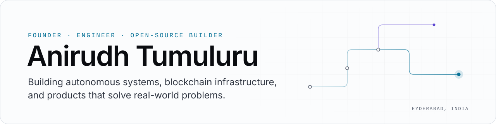
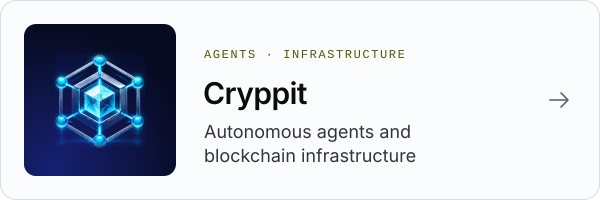

<picture>
  <source media="(prefers-color-scheme: dark)" srcset="assets/profile-hero-dark.svg">
  <source media="(prefers-color-scheme: light)" srcset="assets/profile-hero-light.svg">
  
</picture>

**Founder & engineer.** Building autonomous systems, blockchain infrastructure, and products that solve real-world
problems. Hyderabad, India.

**About me.** Professional footballer: I played in the I-League with NEROCA FC in 2023–24, after district, state
and national levels in India. Fitness freak. Now I build: blockchain tools that show their work, and OnlyKrida, so the
next player gets seen.

[Where's My Swap](https://wheres-my-swap.station-wheres-my-swap.workers.dev) ·
[Zcash Refund Helper](https://cryppit.github.io/zec-refund-helper/) ·
[OnlyKrida](https://onlykrida.com) ·
[LinkedIn](https://www.linkedin.com/in/anirudh-tumuluru-315a7b23b/)

## What I'm building

<a href="https://github.com/cryppit"><picture>
  <source media="(prefers-color-scheme: dark)" srcset="assets/card-cryppit-dark.svg">
  
</picture></a>
<a href="https://wheres-my-swap.station-wheres-my-swap.workers.dev"><picture>
  <source media="(prefers-color-scheme: dark)" srcset="assets/card-wheres-my-swap-dark.svg">
  
</picture></a>
<a href="https://onlykrida.com"><picture>
  <source media="(prefers-color-scheme: dark)" srcset="assets/card-onlykrida-dark.svg">
  
</picture></a>
<a href="https://github.com/Anirudh-712/SUPERCORTEX-"><picture>
  <source media="(prefers-color-scheme: dark)" srcset="assets/card-supercortex-dark.svg">
  
</picture></a>

| | What it is | Status | Look at |
|---|---|---|---|
| **Cryppit** | My company: keyless, read-only tools for cross-chain money, and research into autonomous agents. | Active | [github.com/cryppit](https://github.com/cryppit) |
| **Where's My Swap** | Paste a NEAR Intents order and see every hop to its payout, where the money is now and who can move it. Checks payouts on 33 chains and flags order accounts locked by NEAR Intents' operators. Free, no keys, no sign-in. | Live | [the checker](https://wheres-my-swap.station-wheres-my-swap.workers.dev) · [ZEC route](https://wheres-my-swap.station-wheres-my-swap.workers.dev/zec) |
| **Zcash Refund Helper** | Finds a ZEC or BTC deposit stuck in the NEAR Omni bridge and prints the bridge's own refund steps. Read-only: it never holds keys or signs. 213 tests, MIT, ZECATHON 2026 entry. Used on mainnet on 15 Oct 2026 to return a stuck deposit to its owner's address. | Released v0.1.0 | [repo](https://github.com/cryppit/zec-refund-helper) · [page](https://cryppit.github.io/zec-refund-helper/) |
| **OnlyKrida** | Athlete discovery for India: tested, coach-verified results and opportunities for players the scouting pipeline doesn't reach. | Waitlist | [onlykrida.com](https://onlykrida.com) |
| **Supercortex** | A local-first quant research desk that counts every backtest so the Deflated Sharpe Ratio stays honest, with an Indian crypto-tax cost model and a falsification engine whose job is to kill ideas. Backtests only. | Research prototype | [repo](https://github.com/Anirudh-712/SUPERCORTEX-) |

## Open-source work

Fixes and reports I filed upstream while building these tools. The state column is read from GitHub, as of 19 Oct
2026.

| Project | Contribution | State |
|---|---|---|
| [zingolabs/zingo-mobile](https://github.com/zingolabs/zingo-mobile/pull/1663) | PR #1663: accept every valid NEAR account ID in the swap address check without letting other chains' addresses through | Open, reviewer: "Approving once CI is green" |
| [KeystoneHQ/keystone3-firmware](https://github.com/KeystoneHQ/keystone3-firmware/issues/2313) | Issue #2313: TEX (ZIP 320) addresses fail the transparent-output check | Open, planned for the next feature release |
| [defuse-protocol/defuse-frontend](https://github.com/defuse-protocol/defuse-frontend/pull/999) | PR #999: validate Zcash unified addresses per ZIP 316 (Bech32m, F4Jumble, typecodes) in the NEAR Intents app | Open |
| [horizontalsystems/unstoppable-wallet-ios](https://github.com/horizontalsystems/unstoppable-wallet-ios/issues/7295) | Issue #7295: diagnosed why the Send screen showed a memo field for TEX addresses, then sent a fix (#7299) | Fixed by the maintainers in [#7300](https://github.com/horizontalsystems/unstoppable-wallet-ios/pull/7300), merged |
| [near/docs](https://github.com/near/docs/pull/3121) | PR #3121: Chain Signatures docs point to the live MPC network instead of a fixed node count | Open |
| [Near-One/bridge-sdk-rs](https://github.com/Near-One/bridge-sdk-rs/pull/324) | PR #324: correct BTC refund example (deposit and timelock), from running a real refund | Open |
| [ZcashFoundation/zebra](https://github.com/ZcashFoundation/zebra/issues/11803) | Issue #11803: `z_validateaddress` rejects unified addresses with unknown items that ZIP 316 says to tolerate | Open |
| [zcash/zcash-test-vectors](https://github.com/zcash/zcash-test-vectors/issues/135) | Issue #135: no negative test vectors for unified addresses | Open |

## Engineering

- **Chain forensics from public data.** Tracing an order across NEAR, Bitcoin, Zcash, Solana, TON, EVM chains and
  others, labelling each hop by how it is known, and reading the bridge contract when an indexer lags.
- **Protocol details that lose people money.** ZIP 316 unified addresses, ZIP 320 TEX, consensus branch IDs, memo and
  destination-tag rules, refund timelocks.
- **Serverless products.** Cloudflare Workers and D1, scheduled checks, webhooks, nothing custodial.
- **Range.** [famtv](https://github.com/Anirudh-712/famtv): an ad-free Android TV home screen with an offline Telugu
  panchangam, built without Gradle.

**Stack:** TypeScript · Node · Cloudflare Workers / D1 · Python · Rust · Java (Android) · React / React Native ·
Supabase / PostgreSQL · SQL
